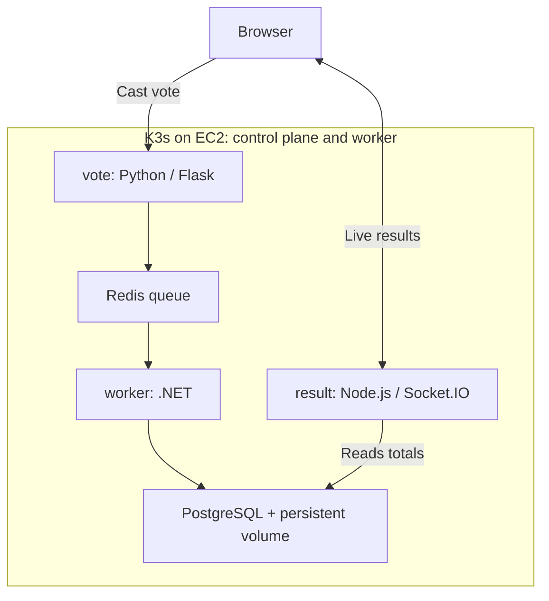
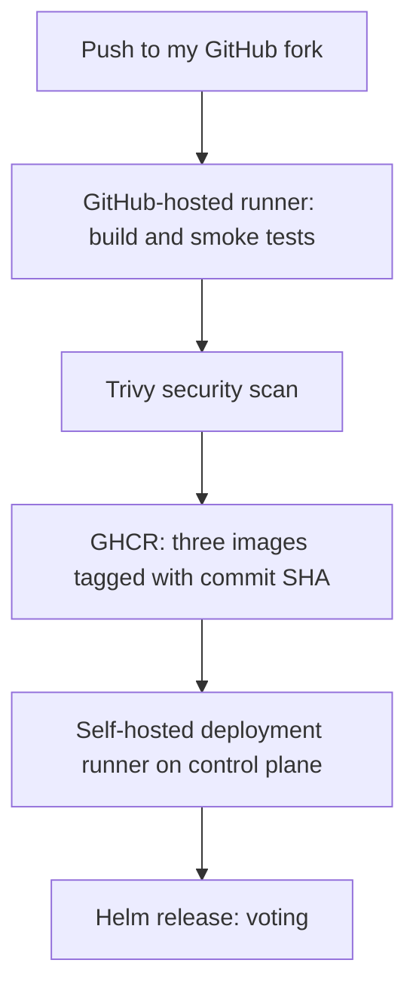

# TS Academy DevOps Capstone 1: Ship It

A voting application delivered from source code to Kubernetes using Docker,
Terraform, GitHub Actions, Trivy, and Helm.

This project is implemented in my own fork of dockersamples/example-voting-app.
The original project documentation is preserved in [README.upstream.md](README.upstream.md).

## Architecture



The vote service queues each submission in Redis. The worker consumes the queue
and saves votes in PostgreSQL. The result service reads totals and sends updates
to the browser. Changing a vote updates the existing voter record.



Terraform provisions two EC2 instances in the existing default VPC in
eu-north-1. They run one K3s control plane and one worker. SSH and public
Kubernetes API access are restricted to the administrator's IPv4 /32.

## Repository layout

- `vote/`: voting application and Dockerfile.
- `result/`: live results application and Dockerfile.
- `worker/`: vote processor and Dockerfile.
- `docker-compose.yml`: local application environment.
- `scripts/smoke-test.sh`: end-to-end voting checks.
- `terraform/`: EC2, networking rules, and K3s installation templates.
- `charts/voting-app/`: one Helm chart with one values file.
- `.github/workflows/capstone-ci.yaml`: build, test, scan, publish, and deploy.

## Prerequisites

Docker with Compose, Git, AWS CLI, Terraform, kubectl, Helm, and an SSH key.

AWS credentials must be configured locally with permission to manage the
resources declared by Terraform. Check authentication with:

```bash
aws sts get-caller-identity
```

The implementation was verified using Helm 4.3.0, kubectl 1.37.1, and
K3s v1.37.1+k3s1.

## Run locally

Create `.env` from `.env.example` if it does not already exist, and fill in
POSTGRES_USER, POSTGRES_DB, and POSTGRES_PASSWORD. Do not overwrite an existing
working `.env`.

```bash
chmod 600 .env
docker compose config --quiet
docker compose up --build -d --wait --wait-timeout 180
bash scripts/smoke-test.sh
```

Open the voting page at http://localhost:8080 and results at
http://localhost:8081.

The smoke test verifies that:
- Both web pages respond.
- The worker creates the votes table.
- A vote reaches PostgreSQL.
- Changing the same voter's choice updates one record.

Application base images are pinned by digest. The three application containers
run as non-root users, and each build context has a `.dockerignore`.

## Provision Kubernetes with Terraform

Create an ignored `terraform/terraform.tfvars` containing:

```hcl
admin_cidr    = "YOUR_PUBLIC_IPV4/32"
ami_id        = "ami-09d835910a77f135c"
instance_type = "m7i-flex.large"
```

This AMI is the Ubuntu 24.04 AMD64 image used for the eu-north-1 deployment.
The default subnet and SSH public key path are declared in `variables.tf`.
Review those values before using another AWS account.

```bash
cd terraform
terraform init
terraform fmt -check
terraform validate
terraform plan -out=cluster.tfplan
terraform apply cluster.tfplan
terraform output
```

Terraform installs K3s through EC2 user data. Verify the resulting cluster:

```bash
ssh -i "$HOME/.ssh/tsacademy-capstone" \
  ubuntu@"$(terraform output -raw control_plane_public_ip)" \
  'sudo cloud-init status --wait; sudo k3s kubectl get nodes'
```

Both nodes must become Ready.

The infrastructure was destroyed and recreated from Terraform during the
capstone. To repeat that demonstration, review and apply a destroy plan, then
review and apply a fresh creation plan:

```bash
terraform plan -destroy -out=destroy.tfplan
terraform apply destroy.tfplan
terraform plan -out=cluster.tfplan
terraform apply cluster.tfplan
```

Destroying the instances deletes their root disks, including local PostgreSQL
storage. Recreation can change public IP addresses.

Free-plan eligibility and credits are account-specific. The instance type used
here was verified as eligible for this account; that is not an unlimited
zero-cost guarantee. Check remaining credits and remove resources when finished.

## Cluster access

For remote administration, copy the server's K3s kubeconfig into a protected,
dedicated local file. Never commit it.

Public API access encountered timeouts during this project. An SSH tunnel
provided working access:

```bash
ssh -N \
  -o ExitOnForwardFailure=yes \
  -o ServerAliveInterval=30 \
  -L 127.0.0.1:16444:127.0.0.1:6443 \
  -i "$HOME/.ssh/tsacademy-capstone" \
  ubuntu@CONTROL_PLANE_PUBLIC_IP
```

Keep that terminal open. In another terminal, select the dedicated kubeconfig
and point its cluster entry at `https://127.0.0.1:16444`.

The deployment runner connects to Kubernetes locally on the control-plane
server and does not depend on the Mac tunnel.

## Install the application with Helm

From the repository root, using the intended kubeconfig:

```bash
kubectl create namespace voting
kubectl create secret generic voting-db \
  --namespace voting --from-env-file=.env

helm lint charts/voting-app
helm upgrade --install voting charts/voting-app \
  --namespace voting \
  --values charts/voting-app/values.yaml \
  --wait --timeout 10m

kubectl get pods,svc,pvc --namespace voting
```

Create the namespace and secret only if they do not already exist.
The `.env` file must contain the three PostgreSQL settings expected by the app.
The chart references the secret; it does not store its password.

The chart deploys vote, result, worker, Redis, and PostgreSQL. PostgreSQL uses a
5 GiB local-path persistent volume. Redis uses ephemeral storage.

For browser access, run these commands in separate terminals:

```bash
kubectl -n voting port-forward --address 127.0.0.1 service/vote 18080:80
kubectl -n voting port-forward --address 127.0.0.1 service/result 18081:80
```

Open http://localhost:18080 and http://localhost:18081.

## Continuous delivery

Every branch push runs the build-test-scan-push job. It:
1. Generates a temporary database password.
2. Builds and starts the Compose environment.
3. Runs the voting smoke tests.
4. Tags the tested images with the full Git commit SHA.
5. Reports HIGH and CRITICAL vulnerabilities, including unfixed findings.
6. Blocks publishing when fixable HIGH or CRITICAL findings exist.
7. Publishes the three images to GitHub Container Registry.

Pushes to `capstone/helm` and `main` in this fork also run the deployment job
after the build job succeeds.

Deployment runs on an existing control-plane EC2 instance, using a self-hosted
runner labelled `capstone-deploy`. It installs the chart with the image tag set
to the workflow's exact commit SHA and waits for readiness.

The runner is registered with GitHub and installed as a systemd service under
the `ubuntu` account. Helm and a protected local kubeconfig at
`/home/ubuntu/.kube/capstone.yaml` are required.

Runner registration and application-secret creation are manual setup steps.
After destroying and recreating the cluster, repeat those steps before expecting
automated deployment to work.

## Demonstrated rollback

The working release was installed as revision 1. An invalid image tag was then
deployed deliberately:

```bash
helm upgrade voting charts/voting-app \
  --namespace voting \
  --values charts/voting-app/values.yaml \
  --set-string imageTag=rollback-demo-invalid \
  --wait --timeout 2m
```

The upgrade failed and new application pods entered ImagePullBackOff.
Existing healthy pods continued running.

The working configuration was restored with:

```bash
helm rollback voting 1 --namespace voting --wait --timeout 5m
helm history voting --namespace voting
kubectl get pods --namespace voting
```

Rollback created revision 3 using revision 1's configuration. When repeating
this exercise later, select the appropriate working revision from Helm history.

## Verified results

- Local voting and smoke tests passed.
- Terraform created, destroyed, and recreated the two-node cluster.
- Both Kubernetes nodes became Ready.
- All five application pods became Ready.
- Votes and changed votes appeared on the results page.
- The deliberate failed release and manual rollback were demonstrated.
- A push successfully tested, scanned, published, and deployed the application.
- All three application deployments were verified using commit
  `a4a25371ff68acc1c2683df8ca41bda07842c4e4` at Helm revision 4.
- The pipeline blocked .NET 10.0.12 findings; updating the pinned runtime to
  10.0.13 allowed the pipeline to pass.

## Secrets and local files

Do not commit `.env`, private SSH keys, kubeconfigs, Terraform state,
saved plans, or real `terraform.tfvars` files.

Terraform state contains the cluster token and must remain protected.
Commit `.terraform.lock.hcl` to preserve provider selections.
